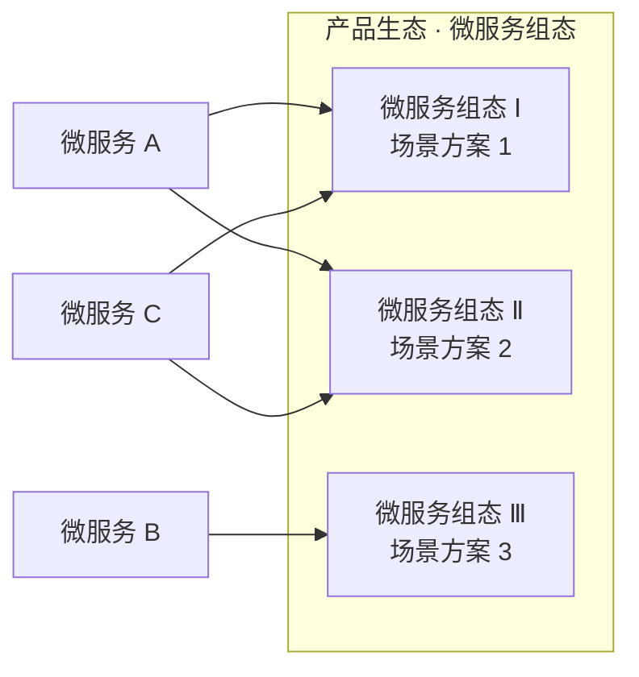
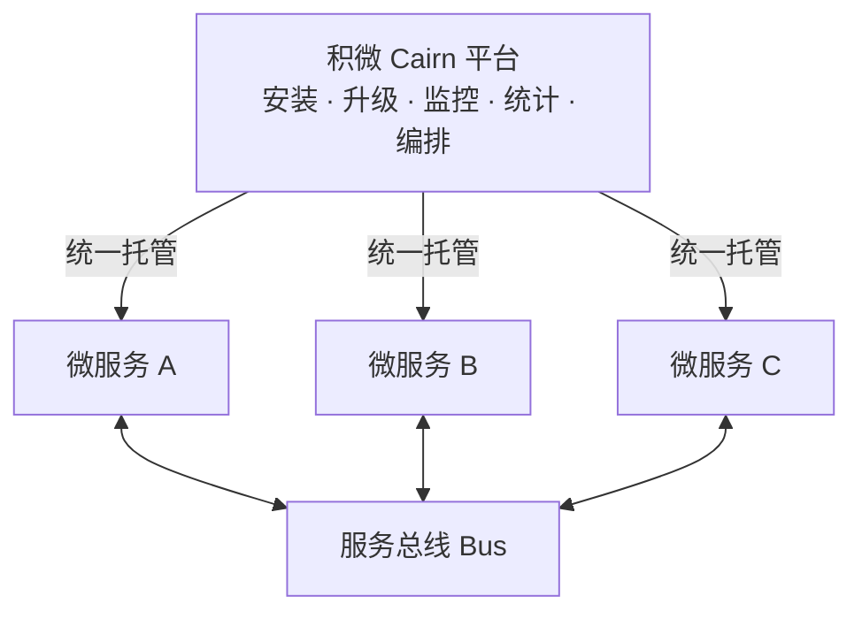

<div align="center">

# 积微 Cairn 微服务管理平台

**Cairn Platform · Microservice Management & Orchestration for IoT**

**安装 · 升级 · 监控 · 统计 · 组态编排 —— 让每一个微服务都成为可复用的积木**

[](./LICENSE)

</div>

---

## 📖 项目简介

**积微 Cairn** 是一个微服务管理平台，核心能力对标经典进程管理工具 Supervisor——但将管理对象从「进程」升级为「微服务」，覆盖微服务从**安装、升级、监控到统计**的完整生命周期。

更进一步，积微 Cairn 支持将微服务**编排**为「**微服务组态**」：多个微服务按业务需要组合成一个完整的功能方案，一次沉淀、处处复用，逐步构建起属于自己的**产品生态**。各微服务之间通过**总线**形式交互，彼此解耦、灵活协作。

> 积微成著，堆石为标（Cairn，意为石冢路标）——每一个微服务，都是产品生态的一块基石。

### ✨ 一分钟了解积微 Cairn

- 🛠 **Supervisor 式微服务管理** —— 安装、升级、监控、统计，微服务全生命周期一站式托管
- 🧩 **微服务组态与编排** —— 将微服务组合成方案级「组态」，构建产品生态
- ♻️ **功能复用、价值放大** —— 同一微服务参与多个组态，一份投入、多份回报
- 🔌 **总线化交互** —— 微服务经由总线通信，彼此解耦、灵活生长
- 🌐 **面向物联网（IoT）** —— 主要应用场景为 IoT，应对分散部署与多样化组合的交付挑战

---

## 🎯 核心功能：微服务全生命周期管理

像 Supervisor 管理进程一样，积微 Cairn 统一管理平台上的每一个微服务——从安装进平台的那一刻起，到每一次版本演进、每一天的运行状况，全程统一照看：

| 能力 | 说明 |
|------|------|
| 📥 **安装** | 将微服务安装至平台，成为统一托管的功能单元 |
| ⬆️ **升级** | 对微服务进行版本升级，功能演进有序推进 |
| 📊 **监控** | 持续关注各微服务的运行状态，运行情况尽在掌握 |
| 📈 **统计** | 汇总微服务运行数据，为运行分析提供数据支撑 |

微服务再多，也只需在一个平台上照看——这是积微 Cairn 对 Supervisor 理念的传承与升级。

---

## 🧩 亮点：微服务组态与编排

这是积微 Cairn 与众不同的地方。

传统微服务管理回答的是「**单个服务怎么跑好**」；积微 Cairn 进一步回答「**一群服务怎么组合成产品**」。

### 什么是「微服务组态」？

「组态」（Configuration）一词源自工业自动化领域：无需从零开发，通过组合现成构件即可搭建出完整的监控系统。积微 Cairn 将这一理念带入微服务世界——

将多个微服务按业务需要**编排**在一起，形成一个面向场景的完整功能方案，即「**微服务组态**」。组态中的每个微服务各司其职，经由总线协同工作，共同交付完整价值。



同一批微服务，不同编排，即可产出面向不同场景的多个方案——这正是组态的力量。

### 组态带来什么？

- **🏗 构建产品生态** —— 微服务与组态持续沉淀，从单一功能生长为方案矩阵，逐步形成完整的产品生态；
- **♻️ 复用微服务功能** —— 同一个微服务可参与多个组态，一处开发、处处可用；
- **📈 放大软件价值** —— 组合越多、复用越广，单次开发的边际回报越高，软件价值被持续放大；
- **🧱 交付像搭积木** —— 面对新需求，优先从既有微服务中选配组合，把「重复造轮子」变成「搭积木」。

---

## 🔌 总线架构：微服务之间怎么对话？

在积微 Cairn 中，微服务之间不采用点对点直连，而是统一通过**总线**交互：



总线带来的架构红利：

- **解耦** —— 微服务之间不感知彼此的位置与实现细节，替换或新增微服务时，其余服务无需改动；
- **统一** —— 所有交互经由同一条总线，协作路径清晰、行为一致；
- **可生长** —— 新微服务接入总线后即可参与编排、进入各种组态，生态随需扩展。

---

## 🌐 IoT 应用场景

物联网是积微 Cairn 的主要应用场景。IoT 项目往往面临三重现实：

- **功能单元多** —— 一个完整的物联网系统，由大量分工不同的功能单元共同支撑；
- **交付组合异** —— 不同客户、不同点位需要的能力组合各不相同，几乎没有两个完全相同的交付；
- **重复投入重** —— 高度重叠的能力在不同项目中被反复开发，成本高、沉淀难。

积微 Cairn 的解法——**把功能做成微服务，把方案做成组态**：

| IoT 挑战 | 积微 Cairn 的回应 |
|----------|-------------------|
| 站点分散、运维吃力 | 在不同部署点位统一完成微服务的**安装与升级**，**监控**运行状态、**统计**运行数据 |
| 需求各异、组合万千 | 通过**组态编排**，同一批微服务灵活组合出面向不同场景的方案 |
| 重复开发、复用困难 | 微服务一次沉淀、多组态复用，交付越多、边际成本越低 |

物联网的碎片化，恰好是微服务组态的主场。

---

## ⚠️ 安全须知（V1 现状）

**当前版本（M1）尚未实现认证与授权**，管理 API 无登录校验。这意味着**任何能访问监听端口的人都可完全接管平台**——安装任意服务、启停进程、上传文件。

为此平台已采取两项默认防线：

1. **默认仅绑定 `127.0.0.1`**（回环地址）。需对外提供服务时必须显式传 `-addr`，并由使用者自行在网络层收敛访问范围（防火墙 / 反向代理 + 访问控制）。
2. **出厂不预置任何升级服务端地址**（TFTP 为空 = OTA 未启用），避免误连内网地址。

> 🚧 **切勿将本版本直接暴露在公网或不可信网络**。认证机制列入 M2 之前的必做项。

---

## 🛠 技术架构与模块

积微 Cairn 控制台为 **Go 单体二进制**（内嵌 Web UI，纯 Go SQLite，无 CGO 依赖），面向边缘现场部署。

```
cairn-platform/
├── main.go                    # 装配入口：logx → store → fork 引擎 → adapt → api → web
├── internal/
│   ├── adapt/                 # 装配层适配器（supervisor → api，依赖方向控制）
│   ├── api/                   # HTTP API：services / manifest（安装制）/ dashboard / settings / logs / upgrade
│   ├── buildinfo/             # 版本信息（构建期注入）
│   ├── config/                # 配置类型、默认值、校验与数据根锚定（CAIRN_ROOT）
│   ├── hostmetrics/           # 主机指标采集（CPU/内存/磁盘/网络，双平台）
│   ├── logx/                  # 日志库：轮转 / gorm 集成 / sink / swap
│   ├── runtime/               # 进程管理器抽象 + fork 实现（进程树管控 / 孤儿认领）
│   ├── store/                 # SQLite 存储层（gorm）
│   ├── supervisor/            # 监管引擎：九态状态机 / 依赖拓扑 / 健康探针 / 重启策略
│   └── web/                   # Web 路由 + 内嵌静态资源
├── configurations/            # 官方组态（场景方案层，按组态持续沉淀）
└── docs/
    └── architecture/          # 架构与设计文档
```

依赖方向：`adapt` 是唯一同时 import `api` 与 `supervisor` 的包，保证 `api` 与 `supervisor` 互不依赖；`runtime` 只回答「进程管理器能做什么」，健康、策略、依赖、版本全部在 `supervisor`。

---

## 🖥 运行环境

**目标运行环境：Linux（amd64 / arm64）与 Windows（amd64）**，面向 IoT 边缘现场部署。

| 环境 | 支持情况 |
|---|---|
| Linux + systemd | 生产目标（arm64 优先，amd64 同源）；平台自身注册 systemd 单元自守护 |
| Windows（amd64） | 运行平台已支持：进程监管、指标采集、安装与升级链路均可用。**平台自守护（SCM 服务封装）尚未实现**，当前需前台或计划任务常驻 |
| 开发机（Windows / Linux） | 真 fork 监管引擎可直接运行，跨平台代码路径一致（`_linux.go` / `_windows.go` 两套 build-tag 实现，暂不支持 macOS） |

平台自身不进自身纳管清单，其存活交由操作系统级守护（Linux systemd `Restart=always` / Windows SCM 服务待实现）。

### 跨平台差异（同一二进制，按 GOOS 编译）

| 能力 | Linux | Windows |
|---|---|---|
| 进程树管控 | `setsid` + 进程组信号 | Job Object（`TerminateJobObject` 一次终结整树） |
| 优雅停止 | 进程组 `SIGTERM` → 宽限 → `SIGKILL` | `CTRL_BREAK_EVENT` → 宽限 → `TerminateJobObject`（无控制台时直接硬杀） |
| 平台重启后继管 | 读 `/proc` 零中断认领孤儿进程 | `GetProcessTimes` 创建时间 + 映像路径校验后零中断认领 |
| PID 复用防护 | `/proc/{pid}/stat` starttime | `GetProcessTimes` 进程创建时间 |
| 主机指标（CPU/内存/磁盘） | `/proc` + `statfs` | `GetSystemTimes` / `GlobalMemoryStatusEx` / `GetDiskFreeSpaceExW` |
| 进程指标（CPU/内存） | `/proc/{pid}` 差分（statm RSS） | `GetProcessTimes` / `GetProcessMemoryInfo`（工作集） |
| 版本切换 | `current` 软链原子切换 | 无软链特权：`current.txt` + DB `Active` 权威 |
| 平台自守护 | systemd 单元（`Restart=always`） | **待实现**：SCM 服务封装未落地 |
| U盘（OTG）升级 | 待实现（`/api/usb/status` 返回 501） | 待实现（同上，需盘符枚举替代挂载点监测） |

> 进程内存口径差异：Linux 取 `/proc/{pid}/statm` 的 RSS（不含共享页），Windows 取 `WorkingSetSize`（含共享/文件映射页），同一负载下 Windows 读数通常偏大，跨平台横向比较时需注意。CPU 口径两侧一致（累计 CPU 时间差分）。

---

## 📁 生产部署布局（Linux）

```
/opt/cairn/                               ← 运行目录（systemd: cairn-console.service，Restart=always 自守护）
├── cairn                                 ← 平台二进制
├── data/                                 ← 平台数据（配置库 / fork 认领登记）
│   ├── cairn.db                          ← SQLite 配置库（WAL）
│   └── runtime/                          ← cairn-{id}.json 进程登记
├── services/                             ← 服务仓库（安装制统一落盘；os/arch 按本机平台自动展开）
│   └── linux/{amd64|arm|arm64}/
│       └── {name}/
│           ├── {version}/bin/…           ← 安装产物
│           ├── {version}/manifest.json
│           └── current → {version}       ← 版本切换软链（Windows 用 current.txt + DB Active）
└── logs/                                 ← 平台日志轮转
```

---

## 🚀 安装与快速上手

**获取源码**：

```bash
git clone https://github.com/jiwei-cairn/cairn-platform.git
cd cairn-platform
```

**构建**（Makefile）：

```bash
make linux          # Linux amd64/arm64 产物
make windows        # Windows amd64 产物
make all            # 全平台
make run            # 本机直跑（真 fork 监管引擎；默认仅监听 127.0.0.1，加 -addr 对外）
make vet            # 双平台编译校验（CI 红线）
```

Windows 用户也可不用 make，直接：

```powershell
go build -o dist\cairn.exe .
```

**生产部署（Linux）**：

```bash
install -D dist/cairn-linux-arm64/cairn /opt/cairn/cairn
cd /opt/cairn && ./cairn -addr :8090
```

**生产部署（Windows）**：将 `cairn.exe` 注册为 Windows 服务后运行（SCM 封装待实现，当前可前台常驻）：

```powershell
dist\cairn-windows-amd64\cairn.exe -addr :8090
```

### 数据根（data / logs / services 的落盘位置）

平台运行数据不依赖进程当前工作目录，按以下优先级锚定（`--root` 可显式覆盖）：

1. `--root <目录>` 命令行标志
2. `CAIRN_ROOT` 环境变量（**Windows 服务注册形态用这个**，服务无法传标志）
3. 可执行文件所在目录（部署形态默认：`cairn[.exe]` 旁生成 `data/` `logs/` `services/`）
4. 当前工作目录（仅 `go run` / `go test` 等开发形态兜底）

> 这一点对 Windows 尤其关键：SCM 启动的服务工作目录默认为 `C:\Windows\System32`，若不锚定就会把数据库与日志静默写进系统目录（非管理员账户下还会直接失败）。

### 核心概念

- **安装制**：所有微服务（自研 + 开源）经「市场 / 本地包 + manifest.json 说明文档」安装进入平台，落盘 `services/{os}/{arch}/{name}/{version}`；平台只管理由平台安装的服务
- **监管**：fork/exec 父子模型 + 九态状态机 + 健康探针（L1 存活 / L2 HTTP·TCP）+ 依赖拓扑编排，supervisor 引擎负责；平台崩溃经孤儿认领零中断恢复
- **升级**：OTA（TFTP）/ OTG（U盘）/ LOCAL（本地包）三来源统一任务管线：下载→验签→预检→停服→安装→切换→健康观察→提交，失败自动回滚

详细设计见 [docs/architecture/](./docs/architecture/)。

---

## 📦 发布路线

平台代码已完成自前身项目向积微 Cairn 的平台化整合，现已以积微 Cairn 的统一身份面向 IoT 场景。

- [x] M1：supervisor fork 引擎 + 安装制 + Windows 平台补齐
- [ ] M2：升级管线（OTA/OTG/LOCAL）完整落地
- [ ] M3：组态编排与总线
- [ ] 首个开源 Release

---

## 🗣 交流与反馈

欢迎通过 [GitHub Issues](https://github.com/jiwei-cairn/cairn-platform/issues) 提交问题与建议。

---

## 📄 许可证

本项目以 [MIT License](./LICENSE) 开源，Copyright © 2026 Cairn。
