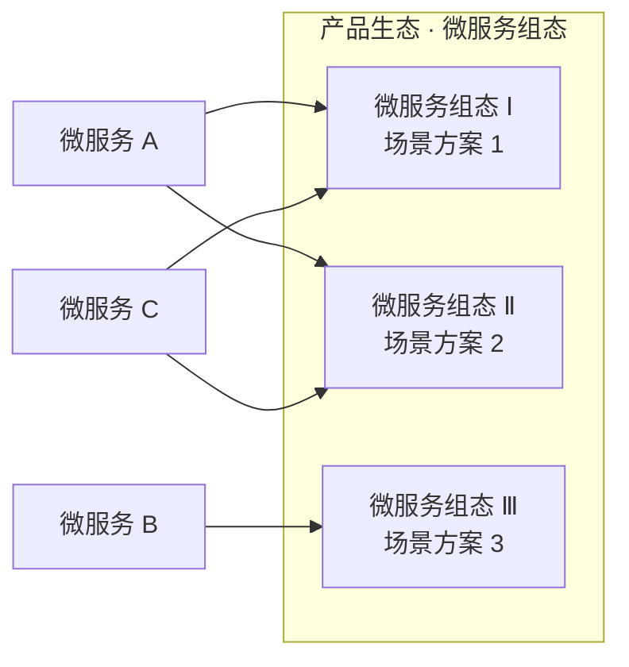
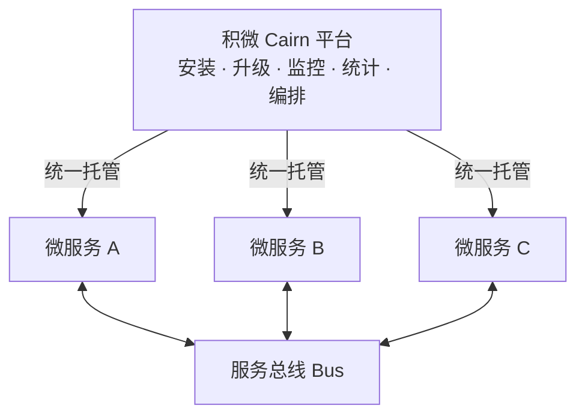

<div align="center">

# 积微 Cairn 微服务管理平台

**Cairn Platform · Microservice Management & Orchestration for IoT**

**安装 · 升级 · 监控 · 统计 · 组态编排 —— 让每一个微服务都成为可复用的积木**

[](./LICENSE)

</div>

---

## 📖 项目简介

**积微 Cairn** 是一个微服务管理平台，核心能力对标经典进程管理工具 Supervisor——但将管理对象从「进程」升级为「微服务」，覆盖微服务从**安装、升级、监控到统计**的完整生命周期。

更进一步，积微 Cairn 支持将微服务**编排**为「**微服务组态**」：多个微服务按业务需要组合成一个完整的功能方案，一次沉淀、处处复用，逐步构建起属于自己的**产品生态**。各微服务之间通过**总线**形式交互，彼此解耦、灵活协作。

> 积微成著，堆石为标（Cairn，意为石冢路标）——每一个微服务，都是产品生态的一块基石。

### ✨ 一分钟了解积微 Cairn

- 🛠 **Supervisor 式微服务管理** —— 安装、升级、监控、统计，微服务全生命周期一站式托管
- 🧩 **微服务组态与编排** —— 将微服务组合成方案级「组态」，构建产品生态
- ♻️ **功能复用、价值放大** —— 同一微服务参与多个组态，一份投入、多份回报
- 🔌 **总线化交互** —— 微服务经由总线通信，彼此解耦、灵活生长
- 🌐 **面向物联网（IoT）** —— 主要应用场景为 IoT，应对分散部署与多样化组合的交付挑战

---

## 🎯 核心功能：微服务全生命周期管理

像 Supervisor 管理进程一样，积微 Cairn 统一管理平台上的每一个微服务——从安装进平台的那一刻起，到每一次版本演进、每一天的运行状况，全程统一照看：

| 能力 | 说明 |
|------|------|
| 📥 **安装** | 将微服务安装至平台，成为统一托管的功能单元 |
| ⬆️ **升级** | 对微服务进行版本升级，功能演进有序推进 |
| 📊 **监控** | 持续关注各微服务的运行状态，运行情况尽在掌握 |
| 📈 **统计** | 汇总微服务运行数据，为运行分析提供数据支撑 |

微服务再多，也只需在一个平台上照看——这是积微 Cairn 对 Supervisor 理念的传承与升级。

---

## 🧩 亮点：微服务组态与编排

这是积微 Cairn 与众不同的地方。

传统微服务管理回答的是「**单个服务怎么跑好**」；积微 Cairn 进一步回答「**一群服务怎么组合成产品**」。

### 什么是「微服务组态」？

「组态」（Configuration）一词源自工业自动化领域：无需从零开发，通过组合现成构件即可搭建出完整的监控系统。积微 Cairn 将这一理念带入微服务世界——

将多个微服务按业务需要**编排**在一起，形成一个面向场景的完整功能方案，即「**微服务组态**」。组态中的每个微服务各司其职，经由总线协同工作，共同交付完整价值。



同一批微服务，不同编排，即可产出面向不同场景的多个方案——这正是组态的力量。

### 组态带来什么？

- **🏗 构建产品生态** —— 微服务与组态持续沉淀，从单一功能生长为方案矩阵，逐步形成完整的产品生态；
- **♻️ 复用微服务功能** —— 同一个微服务可参与多个组态，一处开发、处处可用；
- **📈 放大软件价值** —— 组合越多、复用越广，单次开发的边际回报越高，软件价值被持续放大；
- **🧱 交付像搭积木** —— 面对新需求，优先从既有微服务中选配组合，把「重复造轮子」变成「搭积木」。

---

## 🔌 总线架构：微服务之间怎么对话？

在积微 Cairn 中，微服务之间不采用点对点直连，而是统一通过**总线**交互：



总线带来的架构红利：

- **解耦** —— 微服务之间不感知彼此的位置与实现细节，替换或新增微服务时，其余服务无需改动；
- **统一** —— 所有交互经由同一条总线，协作路径清晰、行为一致；
- **可生长** —— 新微服务接入总线后即可参与编排、进入各种组态，生态随需扩展。

---

## 🌐 IoT 应用场景

物联网是积微 Cairn 的主要应用场景。IoT 项目往往面临三重现实：

- **功能单元多** —— 一个完整的物联网系统，由大量分工不同的功能单元共同支撑；
- **交付组合异** —— 不同客户、不同点位需要的能力组合各不相同，几乎没有两个完全相同的交付；
- **重复投入重** —— 高度重叠的能力在不同项目中被反复开发，成本高、沉淀难。

积微 Cairn 的解法——**把功能做成微服务，把方案做成组态**：

| IoT 挑战 | 积微 Cairn 的回应 |
|----------|-------------------|
| 站点分散、运维吃力 | 在不同部署点位统一完成微服务的**安装与升级**，**监控**运行状态、**统计**运行数据 |
| 需求各异、组合万千 | 通过**组态编排**，同一批微服务灵活组合出面向不同场景的方案 |
| 重复开发、复用困难 | 微服务一次沉淀、多组态复用，交付越多、边际成本越低 |

物联网的碎片化，恰好是微服务组态的主场。

---

## 🚀 安装与快速上手

> 🚧 **开源准备中**：平台源代码正在整理并将陆续开源。首个版本发布后，本节将补充完整的安装步骤与快速上手指引。

**获取源码**：

```bash
git clone https://github.com/jiwei-cairn/cairn-platform.git
cd cairn-platform
```

**保持关注**：

- 点击仓库右上角 **Watch** → **Releases only**（仅关注发布），或点一颗 **Star** ⭐，第一时间获知首个开源版本。

---

## 📁 目录结构

```
cairn-platform/
├── LICENSE          # MIT 开源协议
└── README.md        # 项目说明（本文件）
```

> 仓库正处于开源起步阶段，平台各模块源码将随开源计划陆续合入，目录结构将同步更新。

---

## 🗣 交流与反馈

欢迎通过 [GitHub Issues](https://github.com/jiwei-cairn/cairn-platform/issues) 提交问题与建议。

---

## 📄 许可证

本项目以 [MIT License](./LICENSE) 开源，Copyright © 2026 Cairn。
